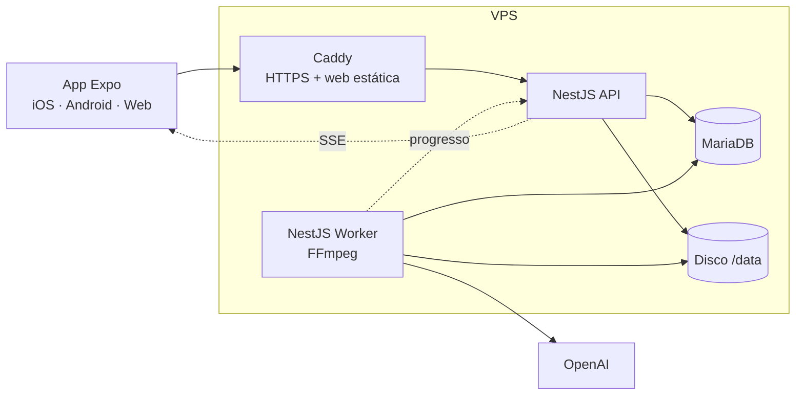

# DOCUMENTO TÉCNICO: Editor de Vídeo Simples

> Como implementar as regras do [PROJETO.md](PROJETO.md). As regras são citadas pelo código (RN-xx, RP-xx, RC-xx).
> Versão 2.0 (simplificada): **NestJS + Prisma + MariaDB + React Native**, tudo numa VPS, na arquitetura do pust.

---

## Decisões de arquitetura desta versão

Este documento descreve **como implementar** as regras do documento Regras de Negócio. Onde ele diverge do que foi escrito antes no editor-video, valem as decisões abaixo.

| Tema | Decisão |
|---|---|
| API | NestJS na arquitetura do **pust/api**: Clean Architecture com CQRS leve. Fluxo oficial: Controller, Facade, Query e Command, com Repository atrás de interface e token de DI. Nenhum caso de uso acessa Prisma direto |
| Banco | **MariaDB** via **Prisma** (provider mysql), com **schema Prisma modular**: um arquivo em `src/modules/[modulo]/prisma/[modulo].prisma`, compilado no `schema.prisma` da raiz. Onde o texto abaixo diz MySQL ou TypeORM, leia MariaDB e Prisma |
| App | Expo e React Native na arquitetura do **pust/mobile**: Expo Router só com entrypoints, `src/modules/[nome]` com `api`, `types`, `queries`, `mutations` e `components` (Container e View, lógica em hooks), TanStack Query, i18n pt-BR, tokens em `constants/theme.ts` |
| Repositório | Um repositório com `api/` e `app/`, mais `docs/` com os documentos e o template de interface |
| Processos | API e worker são o mesmo código NestJS, em dois processos. Execução com **PM2** (`ecosystem.config.js`, como no pust/api). Não usamos Docker |
| Branches | `developer` é a branch de integração: todo trabalho entra nela. `production` só recebe o que já está estável em `developer`, fora da esteira automática |
| Idioma | Código, tabelas, colunas, rotas e chaves em inglês. Interface, mensagens de erro, validação e logs em português do Brasil |
| Tamanho | No máximo 300 linhas por arquivo. Mínimo de comentários. Nunca criar `index.ts` na api |
| Regra de ouro | O backend é a fonte única da verdade. O app só desenha o que a API devolve |

---

## 1. Visão geral

### 1.1 Princípio
**O mínimo de peças.** Tudo roda numa única VPS. A única chamada externa é a **OpenAI** (transcrição e corte com IA).

**O backend é a fonte única da verdade.** Toda regra de negócio e todo cálculo ficam na API; o app é só layout (§8 e §13.4).

### 1.2 Stack

| Camada | Tecnologia |
|---|---|
| API | **NestJS** (TypeScript) com documentação Swagger em `/docs` |
| Processamento | O mesmo projeto NestJS, rodando como segundo processo (**worker**) |
| Banco | **MariaDB** com **Prisma** (inclusive a fila de jobs) |
| Arquivos | **Disco da VPS** (`/data`) |
| Vídeo e áudio | **FFmpeg** instalado na VPS |
| App | **React Native com Expo**: um único app para iOS, Android e Web, na arquitetura do projeto `pust/mobile` |
| IA | **OpenAI** (transcrição e sugestões de corte) |
| Servidor | VPS com PM2 (`api` e `worker`), MariaDB e Caddy (só TLS e proxy reverso) |

### 1.3 O que **não** usamos
Redis, filas externas, armazenamento em nuvem (S3/R2), CDN, captcha externo, Sentry, serviço de push, CI em nuvem e pacotes compartilhados entre API e app. Cada um foi trocado por uma solução dentro da própria stack:

| Necessidade | Solução |
|---|---|
| Fila de jobs | Tabela `jobs` no MariaDB (§6) |
| Guardar vídeos | Pastas no disco da VPS (§5) |
| Progresso em tempo real | SSE, que já vem no NestJS pelo decorator `@Sse` (§12) |
| Antiabuso | Limite de requisições por IP no NestJS + limites de uso (§14) |
| Regras de edição no app | Calculadas só na API; o app apenas exibe o resultado (§8) |

---

## 2. Arquitetura



- A **API** responde ao app, grava no banco, cria jobs e é a **única** a aplicar as regras de negócio. Ela nunca processa vídeo.
- O **worker** busca jobs no MariaDB e faz o trabalho pesado: FFmpeg, transcrição, IA e render. Durante o trabalho, avisa a API do progresso, que repassa ao app por SSE (§12).
- API e worker são o **mesmo código NestJS**, iniciados por comandos diferentes (`main.ts` e `worker.ts`).
- O **app** só desenha o que a API devolve (§13.4).

---

## 3. Estrutura do repositório

```
editor-video/
├── api/                      # NestJS (API + worker)
│   ├── src/
│   │   ├── main.ts           # inicia a API HTTP
│   │   ├── worker.ts         # inicia o worker (contexto Nest sem HTTP)
│   │   ├── common/           # guard de token, filtro de erros, URLs assinadas, config
│   │   ├── projects/         # criar, consultar, descartar, expirar
│   │   ├── upload/           # upload em partes
│   │   ├── processing/       # pipeline inicial (probe, áudio, proxy, transcrição, pausas)
│   │   ├── transcript/       # transcrição, correções, falantes
│   │   ├── editing/          # configurações, cortes, restaurar, desfazer, timeline
│   │   ├── subtitles/        # blocos de legenda, ASS e SRT
│   │   ├── ai/               # análises e sugestões
│   │   ├── exports/          # exportação e download
│   │   ├── jobs/             # fila no MariaDB + executor
│   │   ├── ffmpeg/           # montagem de comandos e execução
│   │   ├── openai/           # cliente de transcrição e de LLM
│   │   └── cleanup/          # exclusão de projetos expirados
│   └── test/
├── app/                      # Expo (arquitetura do pust, §13)
├── fonts/                    # Inter (TTF), usada no render da legenda
├── docker-compose.yml
├── Caddyfile
├── PROJETO.md
└── DOCUMENTO-TECNICO.md
```

Cada módulo NestJS segue o padrão do framework: `*.module.ts`, `*.controller.ts`, `*.service.ts`, `dto/` e `*.entity.ts`.

---

## 4. Banco de dados (MariaDB + Prisma)

Seis tabelas. Tempos sempre em **milissegundos inteiros**, na linha do tempo do vídeo original.

### `projects`
| Coluna | Tipo | Observação |
|---|---|---|
| `id` | CHAR(36) | UUID |
| `token_hash` | CHAR(64) | SHA-256 do token do projeto |
| `ip_hash` | CHAR(64) | Para limites por IP |
| `status` | ENUM | `UPLOADING, PROCESSING, READY, EXPORTING, DONE, ERROR, EXPIRED` |
| `error_code` | VARCHAR | Código da seção 9 do PROJETO.md |
| `original_name`, `size_bytes`, `duration_ms`, `width`, `height` | | Metadados |
| `has_speech`, `low_quality` | BOOL | RN-04.8, RN-04.9 |
| `settings` | JSON | Ferramentas marcadas, níveis, estilo da legenda, formatos, enquadramento |
| `manual_cuts` | JSON | `[{s, e}]` |
| `protected_ranges` | JSON | `[{s, e}]`, trechos restaurados pelo usuário (RN-06.7) |
| `history_cursor` | INT | Posição atual no desfazer/refazer |
| `ai_analyses_used`, `exports_used` | INT | Limites da seção 8 |
| `expires_at` | DATETIME | Envio + 24 h |

### `project_history`
Uma foto do estado de edição (`settings`, `manual_cuts`, `protected_ranges` e decisões da IA) a cada ação do usuário. **Desfazer** = voltar à foto anterior; **refazer** = avançar (RN-11.3). Guarda no máximo 100 fotos por projeto.

### `transcripts`
| Coluna | Conteúdo |
|---|---|
| `project_id` | PK |
| `words` | JSON: `[{i, w, s, e, sp?, f?}]` (palavra, início, fim, falante, `hes`/`mul`) |
| `sentences` | JSON: `[{id, w0, w1, s, e}]` (frases numeradas, usadas pela IA) |
| `pauses` | JSON: `[{s, e}]` (todas as pausas ≥ 300 ms) |

### `ai_suggestions`
`id`, `project_id`, `analysis_no`, `start_ms`, `end_ms`, `category`, `reason`, `decision` (`pending`/`accepted`/`rejected`).

### `exports`
`id`, `project_id`, `format` (`horizontal`/`vertical`), `status`, `progress`, `file_name`, `srt_name`, `error_code`.

### `jobs`
`id`, `project_id`, `type` (`process`, `ai_analysis`, `audio_sample`, `export`), `status` (`queued`, `running`, `done`, `failed`, `canceled`), `payload` JSON, `progress`, `step`, `attempts`, `error_code`, `locked_at`, `created_at`.

---

## 5. Arquivos no disco

```
/data/projects/{projectId}/
├── upload/            # partes do upload (apagadas após juntar)
├── original.<ext>
├── audio.opus         # mono 16 kHz, para transcrição
├── proxy.mp4          # 720p, para o player do app
├── waveform.json      # picos para a linha do tempo
├── samples/           # amostras de áudio (RN-09.6)
└── exports/           # vídeos, SRT e TXT finais
```

- **Download e reprodução**: a API entrega os arquivos por `GET /v1/files/...` com **URL assinada** (HMAC com prazo de 1 h). Isso é necessário porque o `<video>` e o player nativo não enviam o cabeçalho de autorização. O Express do NestJS atende requisições `Range`, então o player consegue buscar qualquer ponto do vídeo.
- **Proteção do disco**: um novo envio é recusado se o espaço livre ficar abaixo de um limite configurável (`MIN_FREE_DISK_GB`), com a mensagem "Estamos com muita demanda agora, tente em alguns minutos."
- **Exclusão**: um cron do NestJS (`@nestjs/schedule`), a cada 15 min, apaga a pasta e os registros de todo projeto com `expires_at` vencido (RN-02.3).

---

## 6. Fila de jobs no MariaDB

- O worker busca o próximo job com uma transação:
  `SELECT ... FROM jobs WHERE status='queued' ORDER BY id LIMIT 1 FOR UPDATE SKIP LOCKED` → marca `running` e `locked_at = now()`.
- Concorrência por tipo, configurável: `export` 1 por vez para cada 4 núcleos; `process` 2; `ai_analysis` 4.
- **Retry**: até 3 tentativas nos erros temporários (rede, OpenAI 5xx/429). Erros de validação falham na hora.
- **Progresso**: o job atualiza `progress` e `step` no banco e avisa a API, que empurra o evento para o app por SSE (§12).
- **Cancelar**: a API marca `canceled`; o worker confere a cada 2 s e, se for o caso, mata o FFmpeg.
- **Recuperação**: ao iniciar, o worker devolve à fila os jobs `running` com `locked_at` antigo (worker reiniciado no meio).

---

## 7. Processamento inicial (RN-03)

Ao concluir o upload, a API cria **um job `process`**, que executa as etapas **em sequência**, cada uma atualizando `step`:

| Etapa (`step`) | O que faz |
|---|---|
| `checking` | `ffprobe`: valida vídeo, áudio, duração e limites (RN-01.3–01.5) |
| `extracting_audio` | `audio.opus` (mono, 16 kHz, 24 kbps) |
| `preparing_preview` | `proxy.mp4`: 720p, H.264, frame rate constante, `+faststart`. Necessário porque MKV, AVI e HEVC não tocam em todos os players |
| `analyzing_audio` | Medição de loudness (1ª passada do `loudnorm`), `silencedetect` e `waveform.json` |
| `transcribing` | Transcrição pela OpenAI (§7.1) |
| `detecting_pauses` | Pausas = intervalos entre palavras ≥ 300 ms, conferidos com o `silencedetect`; marcação de hesitações e muletas (§7.2) |

Se uma etapa falhar, "Tentar novamente" (RN-03.4) recomeça **a partir da etapa que falhou**, porque os arquivos já gerados continuam no disco.

### 7.1 Transcrição (OpenAI)
- Modelo com **tempo por palavra** (hoje: `whisper-1` com `response_format: verbose_json` e `timestamp_granularities: ["word","segment"]`). Modelo definido em `OPENAI_TRANSCRIBE_MODEL`. **Validar na POC** se há modelo melhor com tempo por palavra.
- O áudio é dividido em **pedaços de ~10 min, cortados no meio de uma pausa**. Isso respeita o limite de tamanho de arquivo da API (hoje 25 MB, **validar**). Os tempos de cada pedaço são somados ao seu início.
- O parâmetro `prompt` recebe um texto em estilo literal ("Hum, é… então, tipo…"). Isso aumenta a chance de o modelo escrever as hesitações, que ele costuma omitir.
- Idioma: o primeiro pedaço é transcrito sem forçar o idioma. Se não for português, ou se a confiança média for baixa, `low_quality = true` (RN-04.9).
- **Identificar quem fala** (RN-04.4): uma segunda passada na API da OpenAI, com um modelo que devolve os trechos por falante (`OPENAI_DIARIZE_MODEL`). Cada palavra recebe o falante pelo tempo em que ela cai. Isso dobra o custo da transcrição, então entra no cálculo da POC. Se nenhum modelo atender bem, a alternativa é rodar a separação de vozes na própria VPS.

### 7.2 Hesitações e muletas (RN-05.8 a 05.10)
- `hes` (removível): "hum", "hm", "hã", "ahn", "éé", "eh" **ou** "é" alongado (≥ 400 ms) e isolado por pausa (≥ 250 ms). Na dúvida, **não** marcar. O "é" verbo nunca é marcado.
- `mul` (só destaque): "né", "tipo", "então", "aí", "sabe".
- Trecho com voz, mas sem palavra transcrita, entre 150 e 1200 ms: vira hesitação sem texto.

---

## 8. Edição: cálculo da timeline (API)

**Toda** a lógica de corte fica num serviço da API (`editing/timeline.service.ts`), em funções puras e bem testadas. O app só recebe e exibe o resultado.

**Entrada**: palavras, pausas, `settings`, `manual_cuts`, sugestões da IA aceitas e `protected_ranges`.

**Passos**:
1. **Pausas** (se ativado): cada pausa ≥ o limite do nível vira corte, mantendo o respiro.

   | Nível | Pausa mínima | Respiro |
   |---|---|---|
   | Suave | 1200 ms | 300 ms |
   | Equilibrado | 700 ms | 200 ms |
   | Agressivo | 400 ms | 100 ms |

   O silêncio antes da primeira palavra e depois da última também é cortado (RN-05.3).
2. **Hesitações** (se ativado): o intervalo de cada palavra `hes`.
3. **Juntar** todos os cortes: pausa, hesitação, IA e manual (RC-01).
4. **Subtrair os trechos protegidos** (RC-02). Um corte manual novo sobre um trecho protegido remove a proteção daquele intervalo.
5. **Nunca cortar dentro de uma palavra** (RN-05.2): as bordas são ajustadas para fora das palavras.
6. **Limpar fragmentos**: pedaços mantidos com menos de 150 ms são cortados; cortes com menos de 100 ms são ignorados.
7. **Resultado**: `cuts` (com origem), `kept` (trechos que ficam), `outDurationMs` e estatísticas por origem (RN-05.5, RP-04).

**Como o app usa**: toda ação de edição (mudar configuração, cortar, restaurar, aceitar sugestão, desfazer) é uma chamada à API, que grava a foto em `project_history` e **devolve a timeline já recalculada** na mesma resposta. O cálculo leva poucos milissegundos, então a tela atualiza logo (RP-02).

---

## 9. Corte inteligente com IA (RN-07)

1. O app pede a análise (modo, tipo de conteúdo, duração alvo ou instrução). A API cria um job `ai_analysis`.
2. O worker monta o pedido com a transcrição **em frases numeradas**, já com as correções do usuário:
   ```
   [S1 | 00:00:00 | 4s] Tá gravando? Tá, pode começar.
   [S2 | 00:00:06 | 9s] Olá, pessoal, bem-vindos a mais uma aula.
   ```
   Depois vêm o modo, as regras do tipo de conteúdo (Podcast/Aula) e a lista das frases já cortadas ou protegidas.
3. A OpenAI responde em **JSON com schema estrito** (Structured Outputs):
   `{ outOfScope, note, suggestions: [{ fromId, toId, category, reason }] }`.
4. O worker **valida** cada sugestão: IDs existentes, sem trecho protegido, sem o que já está cortado. Em seguida converte os IDs em tempos (início da frase `fromId` → fim da frase `toId`) e grava as sugestões como `pending`.

Regras:
- A IA **nunca** gera cortes diretamente. Só a sugestão aceita entra na timeline (RN-07.1).
- Como a IA devolve **números de frase**, o corte sempre cai no limite de uma frase e não há tempo inventado (RN-07.5). Falsos começos viram "frases" próprias na montagem das frases (quebra em "—" e "…").
- **Duração alvo**: se o resultado ficar fora de ±10%, o worker faz **uma** segunda chamada informando a diferença. As duas chamadas contam como uma análise.
- **Instrução fora do escopo** (`outOfScope`): mostra a mensagem da seção 9 do PROJETO.md e **não** conta no limite.
- Uma análise nova descarta as sugestões `pending` da anterior (RN-07.8).
- Modelo definido em `OPENAI_LLM_MODEL` (precisa suportar Structured Outputs e contexto ≥ 128 mil tokens; 2 h de fala ≈ 30–40 mil tokens).

---

## 10. Render com FFmpeg

### 10.1 Legendas (RN-08)
- Os blocos são gerados na API (`subtitles.service.ts`) a partir das palavras corrigidas, **sem** os trechos cortados e sem hesitações, e com os tempos já convertidos para o vídeo final.
- Quebra: máximo de 2 linhas; 42 caracteres por linha no horizontal e 22 no vertical; duração do bloco entre 1–6 s no horizontal e 0,7–3 s no vertical. Nunca quebra depois de artigo ou preposição, nem atravessa um corte.
- Render: arquivo **ASS** aplicado pelo filtro `subtitles` com a fonte Inter (`fonts/`):
  - **Clássico**: texto branco com contorno;
  - **Caixa**: texto sobre fundo escuro semitransparente;
  - **Palavra em destaque**: um evento por palavra, com a palavra atual colorida.
- No vertical, a legenda fica fora da faixa inferior e da lateral direita, onde ficam os botões das redes (RN-08.14).
- O **SRT** opcional é gerado dos mesmos blocos.
- O app recebe os mesmos blocos pela API (`GET /subtitles`) e os desenha sobre o player, com a mesma fonte.

### 10.2 Áudio (RN-09)
Cadeia de filtros: micro-fade de 10 ms em cada corte (evita estalos) → `loudnorm` (−16 LUFS, usando a medição do processamento) → `volume` (+25/50/100%) → `alimiter` (sempre por último, para o som não distorcer).
**Amostra** (RN-09.6): job `audio_sample` gera 20 s de um trecho com fala, nas versões "Original" e "Com ajuste".

### 10.3 Enquadramento (RN-10)
- Horizontal → vertical: `crop` na largura `altura × 9/16`, na posição escolhida pelo usuário (0 = esquerda, 0,5 = centro, 1 = direita), seguido de `scale=1080:1920`.
- Vertical → horizontal: `scale` + `pad` com faixas pretas.
- Mesmo formato: só limita a 1080p.

### 10.4 Exportação (RN-12)
- Um único comando FFmpeg por export: `trim/atrim` de cada trecho mantido → `concat` → áudio → enquadramento → legenda. O filtro vai num arquivo (`-filter_complex_script`) porque podem ser centenas de trechos.
- Codificação: H.264 (`-preset veryfast -crf 20`), AAC 160 kbps, `+faststart`, frame rate constante, no máximo 1080p.
- Progresso lido de `-progress pipe:1`.
- Com os dois formatos marcados, gera dois jobs (um por formato).
- Validações antes de exportar: pelo menos 1 formato (RP-01), vídeo final ≥ 3 s (RN-12.11) e limite de exportações.
- Nome do arquivo: `nome-original_editado_horizontal.mp4` / `_vertical.mp4` (RN-12.4).

---

## 11. API

### 11.1 Convenções
- Base `/v1`, JSON.
- **Acesso sem conta**: `POST /v1/projects` devolve um **token aleatório** (uma única vez). O banco guarda só o hash. As demais rotas exigem `Authorization: Bearer <token>`, validado por um guard do NestJS.
- **Link do projeto**: `https://<dominio>/p/{id}#t={token}`. O token vai depois do `#`, então não aparece nos logs do servidor.
- **Erros**: `{ "statusCode": 422, "code": "VIDEO_TOO_LARGE", "message": "Esse vídeo tem 2,4 GB. O limite é 2 GB." }`. Os `code` seguem a seção 9 do PROJETO.md.
- **Validação**: DTOs com `class-validator`.
- **Limite de requisições**: `@nestjs/throttler` por IP.

### 11.2 Documentação
- `@nestjs/swagger`: decorators nos DTOs e controllers geram o OpenAPI automaticamente.
- **Swagger UI em `/docs`** e o JSON em `/docs-json`.
- Cada rota tem resumo, a regra que implementa (RN-xx) e os códigos de erro possíveis.

### 11.3 Rotas

| Método | Rota | Para quê | Regras |
|---|---|---|---|
| GET | `/v1/config` | Limites vigentes (para validar antes de enviar) | RN-01.3 |
| POST | `/v1/projects` | Cria o projeto (nome, tamanho) → `id`, `token`, tamanho da parte | RN-01, RN-02 |
| GET | `/v1/projects/:id` | Estado, etapa, progresso, metadados, URLs assinadas (proxy, waveform), resumo | RN-02.4, RN-03.1 |
| DELETE | `/v1/projects/:id` | Descartar projeto (apaga tudo) | RN-02.5 |
| PUT | `/v1/projects/:id/upload/:index` | Envia a parte `index` (8 MB) | RN-01 |
| GET | `/v1/projects/:id/upload` | Partes já recebidas (para retomar) | RN-01.7 |
| POST | `/v1/projects/:id/upload/complete` | Junta as partes e inicia o processamento | RN-03 |
| POST | `/v1/projects/:id/retry` | Tenta de novo a etapa que falhou | RN-03.4 |
| GET | `/v1/projects/:id/transcript` | Palavras e frases | RN-04 |
| PATCH | `/v1/projects/:id/transcript` | Corrige palavras `[{i, w}]` | RN-04.5 |
| GET | `/v1/projects/:id/timeline` | Timeline calculada (§8) | RN-11, RP-04 |
| PUT | `/v1/projects/:id/settings` | Ferramentas e opções → timeline | RP-02, RP-05 |
| POST | `/v1/projects/:id/cuts` | Corte manual (por palavras ou por tempo) → timeline | RN-06 |
| POST | `/v1/projects/:id/restore` | Restaura um trecho (vira protegido) → timeline | RN-06.7, RN-11.2 |
| POST | `/v1/projects/:id/undo` · `/redo` | Desfazer / refazer → timeline | RN-11.3 |
| GET | `/v1/projects/:id/subtitles?format=` | Blocos de legenda para o preview | RN-08 |
| POST | `/v1/projects/:id/ai/analyses` | Pede uma análise | RN-07 |
| GET | `/v1/projects/:id/ai/suggestions` | Sugestões da última análise | RN-07.2 |
| PATCH | `/v1/projects/:id/ai/suggestions/:sid` | Aceitar/recusar uma → timeline | RN-07.1 |
| POST | `/v1/projects/:id/ai/suggestions/all` | Aceitar/recusar todas → timeline | RN-07.4 |
| POST | `/v1/projects/:id/audio-sample` | Gera a amostra de áudio | RN-09.6 |
| POST | `/v1/projects/:id/exports` | Inicia a exportação (formatos, SRT, TXT) | RN-12 |
| GET | `/v1/projects/:id/exports` | Status, progresso e links de download | RN-12 |
| DELETE | `/v1/projects/:id/exports/:eid` | Cancela uma exportação | RN-12.8 |
| GET | `/v1/projects/:id/events` | Fluxo SSE: estado, progresso, fim de análise e de exportação | RN-03.1, RN-12 |
| GET | `/v1/files/:id/:name?exp=&sig=` | Entrega um arquivo (com suporte a `Range`) | RN-12.5 |

---

## 12. Progresso em tempo real (SSE)

O app acompanha o processamento ao vivo, sem serviço externo: o NestJS já traz **Server-Sent Events** pelo decorator `@Sse`.

**Caminho do evento**
1. O worker grava `progress` e `step` no MariaDB e chama a API em `POST /internal/events` (só pela rede interna do Docker, com um segredo compartilhado).
2. A API publica o evento num `Subject` do RxJS, em memória.
3. `GET /v1/projects/:id/events` entrega esse fluxo, filtrado pelo projeto, como SSE.

**Eventos**

| Evento | Conteúdo |
|---|---|
| `project.state` | `status` e `errorCode` |
| `processing.progress` | `step`, `stepProgress` e `overall` |
| `ai.analysis` | `status` da análise |
| `audio.sample` | `status` e links da amostra |
| `export.progress` | `exportId`, `format` e `progress` |
| `export.done` | `exportId` e `format` |

**Regras**
- **Autenticação** pelo cabeçalho `Authorization`, como nas outras rotas. Na web, o cliente é o `@microsoft/fetch-event-source`, porque o `EventSource` do navegador não envia cabeçalhos; no nativo, o `react-native-sse`.
- **Heartbeat** a cada 20 s, para a conexão não cair no proxy. O Caddy fica com buffer desligado nessa rota.
- **Reconexão**: o cliente reenvia `Last-Event-ID`; a API manda o estado atual antes de voltar ao fluxo.
- **Rede de segurança**: a API relê o estado no MariaDB a cada 5 s e emite o evento se algo mudou sem aviso (worker reiniciado, evento perdido). O app também refaz `GET /v1/projects/:id` ao reconectar, então nada depende só do evento.
- **Escala**: com mais de uma instância da API (hoje só existe uma), o `Subject` em memória deixa de bastar, e essa leitura periódica do MariaDB passa a ser a origem dos eventos.
- O trabalho **continua no servidor com o app fechado** (RN-12.7). O SSE só mostra o andamento, não o executa. Ao reabrir o link, o estado vem do banco. Não há notificação push, que dependeria de serviço externo.

---

## 13. App React Native (Expo)

### 13.1 Base
- **Um único app Expo para iOS, Android e Web** (React Native Web, `expo export -p web`), com a mesma stack e a mesma arquitetura do `pust/mobile`: Expo Router, TypeScript strict, TanStack Query, i18next (só pt-BR), fonte Inter, eslint + prettier, máximo de 300 linhas por arquivo.
- As skills `component-architecture` e `design-system-layout` do pust são copiadas para `app/.claude/skills/`.

### 13.2 Estrutura (igual à do pust)
```
app/
├── app/                        # rotas (só entrypoints)
│   ├── _layout.tsx             # fontes, splash, CoreProvider
│   ├── index.tsx               # landing (web) / início (nativo)
│   └── p/[projectId]/          # index (envio/processamento/painel), review, export
├── src/
│   ├── components/{layout,shared,ui}
│   ├── config/api.ts           # BASE_URL = EXPO_PUBLIC_API_URL
│   ├── constants/theme.ts      # tokens do design system
│   ├── hooks/                  # use-palette, use-breakpoint...
│   ├── i18n/                   # pt-BR, incluindo errors.json (mensagens da seção 9 do PROJETO.md)
│   ├── modules/                # por domínio
│   ├── providers/              # CoreProvider: I18n → Query → ColorScheme → Theme → Toast
│   └── shared/lib/             # api-error.ts, http-interceptor.ts, confirm-dialog.ts
└── design-system/              # documentação dos tokens
```

**Módulos**: `project`, `upload`, `tools` (painel), `transcript`, `timeline`, `player`, `ai`, `export`.
Cada um tem `*.api.ts`, `*.types.ts`, `*.queries.ts`, `*.mutations.ts`, `*.storage.ts` (quando precisa) e `components/` + `hooks/`, no padrão **Container + View** com a lógica em hooks.

### 13.3 Pontos específicos
- **Token do projeto**: `project.storage.ts` guarda no SecureStore (nativo) ou no `localStorage` (web), como o `auth.storage.ts` do pust. Também guarda a lista "Continuar editando".
- **Upload** (`useUpload`): lê o arquivo em partes de 8 MB (`expo-file-system` no nativo, `File.slice()` na web, em `upload.reader.web.ts`) e envia até 3 partes ao mesmo tempo. Guarda as partes concluídas para retomar (RN-01.7).
- **Player** (`useEditorPlayer`): toca o `proxy.mp4` com `expo-video` e, no modo "Resultado final", pula os trechos fora de `timeline.kept` (RN-11.6). A legenda (`SubtitleOverlay`) e o quadro 9:16 arrastável (`FramingOverlay`) ficam sobre o vídeo.
- **Linha do tempo**: `react-native-svg` com a forma de onda e os cortes coloridos por origem.
- **Transcrição**: lista virtualizada por frase; tocar → vai ao ponto; selecionar → "Cortar trecho"; riscado → "Restaurar".
- **Download**: no nativo, baixa com `expo-file-system` e salva na galeria (`expo-media-library`); na web, link direto para a URL assinada.
- **Só na web** (arquivos `.web.tsx`): arrastar e soltar o vídeo, atalhos de teclado e aviso ao fechar a aba (RN-02.6).
- **Layout**: 3 colunas na tela larga (texto · player · painel), abas no celular (Vídeo · Texto · Linha do tempo · IA), usando `useIsMobile`/`useIsNarrow` do pust.
- **Tempo real**: `events.client.ts` (react-native-sse) e `events.client.web.ts` (`@microsoft/fetch-event-source`) recebem os eventos do §12 e atualizam o React Query.

### 13.4 O app é só layout

O backend é a fonte única da verdade. O app não decide nada de negócio:

| O app faz | O app não faz |
|---|---|
| Mostra o que a API devolve: timeline, blocos de legenda, sugestões da IA, resumo de duração | Calcular cortes, respiros, durações, quebras de legenda ou o que deve ser sugerido |
| Manda a intenção do usuário: "cortar daqui até ali", "nível agressivo", "aceitar esta sugestão" | Manter uma segunda versão do estado da edição |
| Guarda só estado de tela: aba aberta, zoom da linha do tempo, seleção, texto sendo digitado | Validar limites por conta própria (usa `GET /v1/config` só para avisar antes; quem recusa é a API) |
| Traduz o `code` do erro para a mensagem em português (`i18n/errors.json`) | Inventar mensagem que a API não mandou |

Na prática: **toda ação de edição é uma chamada que devolve a timeline já recalculada** (§8), e a tela só redesenha com a resposta. O desfazer/refazer também é do servidor (`project_history`), então o mesmo projeto aberto no computador e no celular mostra sempre o mesmo estado.

---

## 14. Segurança e privacidade

- Token de projeto aleatório (256 bits), guardado só como hash; URLs de arquivo assinadas e com prazo.
- Arquivo validado pelo **ffprobe** (conteúdo), não pela extensão; FFmpeg com `-protocol_whitelist file,pipe`.
- **Antiabuso sem serviço externo**: `@nestjs/throttler` por IP, no máximo 1 projeto processando por IP, limites da seção 8 do PROJETO.md e proteção de disco (§5).
- Exclusão automática em 24 h (§5); o botão "Descartar" apaga na hora.
- Os logs nunca guardam o token, o texto da transcrição nem o nome do arquivo.
- Para a OpenAI vão só o **áudio** (transcrição) e o **texto** (análise pedida pelo usuário). Conferir a política de retenção vigente da API.
- MariaDB e worker **sem porta exposta** para a internet; só o Caddy (80/443) fica aberto.

---

## 15. Implantação na VPS

### 15.1 Máquina inicial
**8 vCPU dedicadas, 16 GB de RAM, 500 GB de disco.** O disco é o que mais pesa: com a retenção de 24 h, um projeto ocupa ~2× o original. Aumentar CPU e disco conforme o uso.

### 15.2 Processos com PM2

Dois processos no mesmo `ecosystem.config.js`, como no pust/api: `podcast-api` (`dist/src/main.js`) e `podcast-worker` (`dist/src/worker.js`), com `autorestart`, backoff exponencial entre reinícios e logs em `/var/log/pm2`. O Caddy só cuida do HTTPS (certificado automático), encaminha `/v1` e `/docs` para a API e serve a web estática do app.
### 15.3 Deploy
Um script `deploy.sh` na VPS: `git pull` → `pnpm build` → migrações do Prisma → `pm2 reload ecosystem.config.js` → `expo export -p web` para `app/dist`.
App nativo: builds locais (`eas build --local` ou `expo run`) e envio às lojas.

### 15.4 Operação
- **Backup**: `mariadb-dump` diário para uma pasta da própria VPS, com 7 dias de retenção. Os vídeos não entram no backup, porque vivem só 24 h.
- **Logs**: `docker compose logs` (JSON do logger do NestJS).
- **Saúde**: `GET /health` verifica o MariaDB e o espaço em disco.

### 15.5 Variáveis de ambiente
`DATABASE_URL`, `DATA_DIR=/data`, `FILE_URL_SECRET`, `OPENAI_API_KEY`, `OPENAI_TRANSCRIBE_MODEL`, `OPENAI_DIARIZE_MODEL`, `OPENAI_LLM_MODEL`, `MIN_FREE_DISK_GB`, `EXPORT_CONCURRENCY` e os limites (`LIMIT_MAX_SIZE_BYTES`, `LIMIT_MAX_DURATION_MS`, `LIMIT_RETENTION_HOURS`, `LIMIT_EXPORTS`, `LIMIT_AI_ANALYSES`). No app: `EXPO_PUBLIC_API_URL`.

---

## 16. Testes

| O quê | Como |
|---|---|
| Timeline e legendas (`timeline.service`, `subtitles.service`) | Testes unitários (Jest, padrão do NestJS). É a parte mais importante: pausas, protegidos, respiros, "é" verbo, quebras de linha |
| Rotas da API | Testes e2e do NestJS (supertest) com um MariaDB de teste |
| Render | Vídeos curtos de teste em `api/test/fixtures` (podcast com 2 vozes, aula com silêncios, sem fala, sem áudio, vertical de celular, MKV). Conferir a duração final, a sincronia da legenda e o volume |
| App | Jest (`jest-expo`) nos hooks principais + roteiro manual na web, no Android e no iOS |

---

## 17. Roadmap

Todas as fases fazem parte da entrega: a ordem abaixo é só a sequência de construção, nenhuma funcionalidade fica de fora.

| Fase | Entrega |
|---|---|
| **F0** | Repositório, Docker Compose, NestJS com `/health` e `/docs`, app Expo no padrão do pust |
| **F1 (POC)** | Transcrição com OpenAI em pedaços, export com muitos cortes; medir tempo e custo de 1 h de vídeo |
| **F2** | Projeto, upload retomável, processamento, transcrição na tela (RN-01 a RN-04) |
| **F3** | Timeline, pausas, hesitações, edição pelo texto, desfazer, export horizontal (RN-05, 06, 11, 12) |
| **F4** | Legendas, áudio, vertical (RN-08, 09, 10) |
| **F5** | IA (RN-07) |
| **F6** | Builds iOS/Android, limites, exclusão e antiabuso, landing |

---

## 18. Pontos a validar na POC

| Ponto | Por quê |
|---|---|
| Modelos, limites e preços atuais da OpenAI | Tempo por palavra, separação de falantes e limite de arquivo mudam com o tempo |
| Hesitações na transcrição | O modelo tende a omiti-las; medir com o prompt literal e a detecção por áudio |
| Tempo de render de 2 h com centenas de cortes | Define a concorrência e o tamanho da VPS |
| Upload grande no celular com o app minimizado | Pode interromper; o plano B é pedir para manter o app aberto |
| Desempenho da transcrição longa na web | 18 mil palavras numa lista virtualizada |
